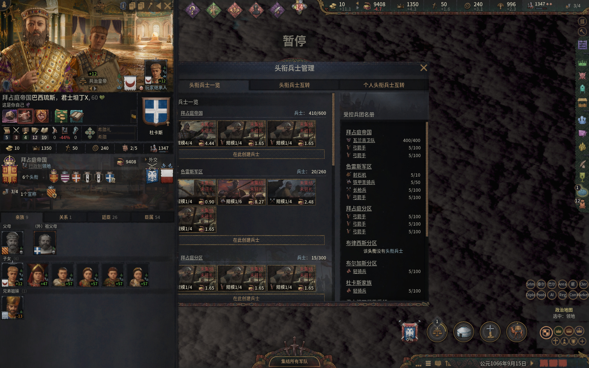
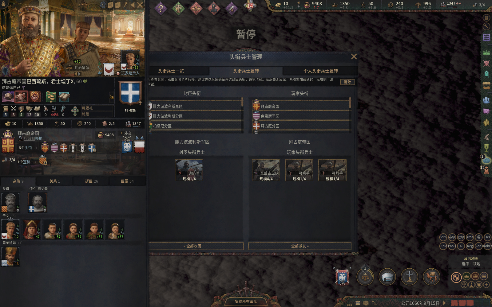
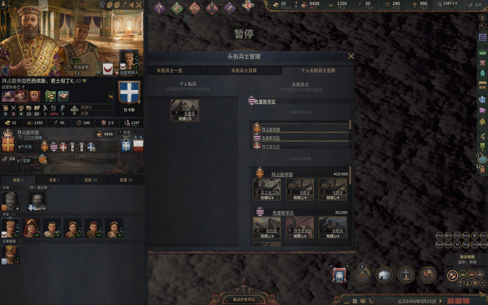

# 节制天下兵马！（头衔兵士管理）

**2026.11.19.15 · CK3 1.21**　[Steam 创意工坊](https://steamcommunity.com/sharedfiles/filedetails/?id=3636472421) · [更新说明](docs/工坊更新说明.txt)

你可以**为自己持有的任意头衔建立头衔兵士**，也可以把已有军团划拨给自己或封臣名下的任意头衔。想把地方兵权收归中央，就把各地的头衔兵调到主头衔；想让封臣掌兵，就把军团拨到他名下指定的头衔。你还可以把个人私兵编入头衔，把头衔常备军收为私兵，或只借出指挥权，让军团保留原来的归属。

右键自己，选择**「头衔兵士管理（天下兵马）」**，即可使用下面三个分页。右键封臣选择同一入口，会直接打开「头衔兵士互转」。

## 头衔兵士一览

左侧按你持有的头衔列出军团，点击卡片可以查看详情。右侧的**「受控兵团名册」**列出各头衔正在指挥的军团、现役人数和满编人数。借来的兵会标出原属头衔。

在自己持有的任意头衔那一行点**「在此创建兵士」**，就能为它新建军团。原版招募窗以你的主头衔为招募来源，按窗口报价扣费，新团归入你在管理页选定的头衔。选兵期间也可以改选归属头衔。

## 头衔兵士互转

右键封臣进入时，左边是封臣的头衔，右边是你的头衔。两边各选一个头衔，再点要调走的军团。点左侧的团，就把它收归右侧选中的头衔。点右侧的团，就把它拨给左侧选中的封臣头衔。**「全部收回」**和**「全部派发」**可以一次调走出兵头衔名下的全部军团。

右键自己进入时，两边都列出你持有的全部头衔。例如，要把几个地方头衔的兵集中到主头衔，可以在右侧选好主头衔，左侧依次选出兵头衔，逐批收回。

## 个人头衔兵士互转

**把私兵编入头衔。**先选接收军团的头衔，再点左侧的一支个人兵团。这支兵就编入该头衔，此后可以随其他头衔兵一同调拨。

**把头衔兵收为私兵。**先选好一个头衔。右侧名册仍会列出你所有头衔正在指挥的军团，其中也可能有借来的兵。找到要改编的那支团，点它的卡片，转为你个人常备军的就是这支团。

## 借兵、阅兵与收天下兵

**借兵**时，右键有主头衔的接收人，选择自己的出兵头衔。兵团仍归原头衔，由对方的主头衔指挥。

**阅兵仪式**主要用来清点目标人物的全部头衔兵。右键目标人物选择「阅兵仪式」，可以逐个选择对方的头衔，在确认框里查看该头衔有哪些军团。只想清点兵力，看完就退出即可。如果发出请求并获对方接受，只有本次选中头衔的兵团会交由你的主头衔指挥。

要解散指定封臣公国的兵团，用人物互动**「裁撤冗兵」**。要把各级封臣的头衔兵全部收归中央，用决议**「收天下兵（天下兵马）」**，收回的军团会集中到你的主头衔。

## 更新公告｜2026年11月19日

- **适配 CK3 1.21。**
- **整合管理窗口。**头衔兵士一览、头衔兵士互转和个人头衔兵士互转现在共用一个窗口。与窗口功能重复的旧互动默认隐藏。如果窗口里的操作失效，可以在人物菜单中选择「展开备用互动（天下兵马）」，改用对应的旧互动。
- **军事页面的扩展分页改为独立窗口。**现在右键人物即可打开「头衔兵士管理」，无需覆盖原版军事界面，提高了与其他模组的兼容性。

## 适用范围与兼容性

**兼容性较高，兼容大部分模组。**头衔兵士管理使用独立窗口，招募沿用游戏原有的弹窗，原版军事界面和招募界面均无需替换。

本作可独立启用。各政体的玩家都可以从管理窗口调拨头衔兵、把个人兵团编入头衔，或把头衔兵收为私兵。新建军团时，可招募的兵种、购买条件与费用以原版招募窗为准。

本作也可以配合[《节制天下兵马：军政分离与协防体系》](https://steamcommunity.com/sharedfiles/filedetails/?id=3729043634)使用。在天朝制下，协防、乡勇契约可以让封臣使用头衔兵士。你可以用本作把军团划拨到这些封臣名下的指定头衔。

**适用游戏版本 CK3 1.21.*｜简体中文**
天下兵马系列 Mod 反馈群　**QQ 108936531**

## 发布文件

本仓库的模组文件与此版 Steam 订阅下载件逐文件一致，清单共 39 项。运行 `python tools/核对源码快照.py` 可核对源码与封面。

[文件清单](docs/源码清单_20261119.json) · [工坊介绍原文](docs/工坊介绍_BBCode.txt) · [原版招募窗实机图](docs/gallery/04-title-regiment-recruitment.jpg) · [反馈问题](https://github.com/apo-so/Title-MAA-Manager/issues)

## 源码与许可

本仓库目前**未添加开源许可证**。公开可见并不意味着授权任何第三方复制、修改或重新发布。涉及第三方或原版资源的再发布，应先确认相应权利及许可。
